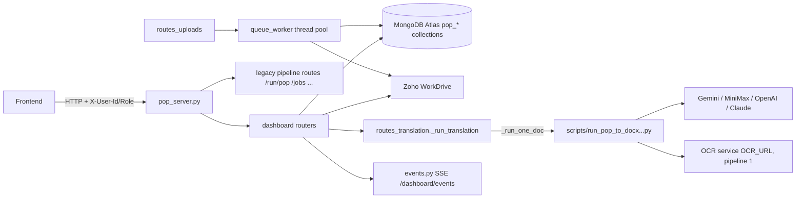

# POP-Translation: repo index

A navigation map for finding where a change belongs. It complements `CLAUDE.md` (rules and
invariants) and does not repeat them. Built from the module docstrings, route decorators and
function lists as of branch `first_render`; line numbers drift, so grep for the symbol.

## 1. What runs

One FastAPI app, `pop_server.py` (port 8032), two halves:

| Half | Where | What |
|---|---|---|
| Pipeline server | `pop_server.py`, `scripts/run_pop_to_docx_updated_pagewise_docx.py`, `helpers/zoho_workdrive.py`, `_job_ctl.py` | Zoho-backed state/crop tree, `POST /run/pop`, in-memory `_jobs`, master JSON cache |
| Dashboard | `dashboard/` mounted at `/dashboard` | MongoDB catalogue: listing, uploads, translation jobs, dedup review, files |

## 2. Data model (MongoDB, every collection `pop_` prefixed)

Constants live in `dashboard/models.py`; factories `new_*` build rows.

| Collection | Role |
|---|---|
| `pop_documents` | Main table. One row per placement (file x state x folder). Pure association, id `POP_#####` |
| `pop_unique_documents` | One row per distinct document (sha256). All metadata, translation/review state, `duplicate_links`, `main_row_ids`, `representative_file_id`. Id `ANNAM_#####` |
| `pop_states`, `pop_crops`, `pop_organizations`, `pop_org_master`, `pop_crop_aliases`, `pop_districts`, `pop_kvks`, `pop_languages` | Vocabularies, id-only, read-only over HTTP |
| `pop_upload_queue_items`, `pop_upload_trail` | Upload queue; finished items move to the trail |
| `pop_translation_jobs` | Per-document translation jobs (page_links, page_file_ids, page_stage, mode, pipeline, model, cost_usd, batch_name) |
| `pop_approvers` | "edit" and "upload" permission lists |
| `pop_config` | Config rows |

Enums (wire format, do not rename): `TranslationStatus`, `ReviewStatus`, `UploadQueueStatus`
(queued, hashing, checking_duplicate, awaiting_review, uploading, done, failed),
`TranslationJobKind` (translate, review_upload), `TranslationMode` (normal, flex, batch),
`TranslationJobStatus` (queued, running, done, failed, cancelled).

Placement/document linkage is maintained only by `link_placement()` / `unlink_placement()`
in `models.py`. Display ids: `dashboard/display_id.py`.

## 3. Dashboard modules (`dashboard/`)

| File | Responsibility | Key symbols |
|---|---|---|
| `config.py` | Only place env vars are read; `POP_ENV` picks staging/prod DB | `TRANS_ENABLED`, `OCR_URL`, `flash_api_key`, Zoho folder ids |
| `db.py` | Lazy Mongo connection, vocab collection accessors | `get_db`, `get_session`, `crops_collection`, `organizations_collection` |
| `access.py` | Identity from headers, roles, lists | `caller`, `require_admin`, `require_editor`, `Caller` |
| `models.py` | Collections, enums, factories, placement linking | see section 2 |
| `schemas.py` | Pydantic response/request models, `UTCDatetime`, `Paginated` | `DocumentOut`, `UniqueDocumentOut`, `TranslationJobOut`, `UploadQueueItemOut` |
| `routes_documents.py` | Main table, filters, PATCH/DELETE, placements, vocabularies, stats | `_DOCUMENT_FILTERS`, `_JOINED_FILTERS`, `_reject_unknown_filters` |
| `routes_uploads.py` | Upload queue API and the approval chain (levels 0/1/2) | `create_upload`, `_actions`, `_visible_filter`, `approve/decline/add/new/cancel` |
| `queue_worker.py` | Background upload phases, duplicate candidates, Zoho upload, filing | `_check`, `_finish`, `find_candidates`, `create_placements` |
| `routes_translation.py` | Translate/review endpoints, job runner, batch poller, cost | `_run_translation`, `start_translation`, `_poll_batches`, `_cost_usd` |
| `routes_files.py` | Zoho view/download proxy | `_NAMED_KINDS` |
| `routes_merge.py` | Find duplicates, merge, unlink, delete copy link | `merge_documents`, `find_duplicates_*` |
| `routes_dedup.py`, `dedup_groups.py` | Duplicate-group review and verdicts | `mark_same`, `mark_different`, `reset_verdict`, `rebuild_associations` |
| `dedup.py`, `chunk_store.py` | sha256 / embedding signature; chunk embeddings joined from local `fix/out/` | `compute_signature`, `find_closest_match`, `verdict_against` |
| `routes_access.py` | `/me`, user-management lists | |
| `events.py` | SSE bus | `publish`, `upload_changed`, `translation_changed`, `document_changed` |
| `vocabulary.py`, `languages.py`, `zoho_layout.py` | Id-only vocab helpers, state_code to OCR model table, Zoho folder layout | `STATE_LANG`, `CORPUS_FOLDER_CODE` |
| `static/dedup_review.html` | Served by `GET /dashboard/dedup-review` | |
| `migrate_*.py` | One-off loaders, run by hand | `migrate_from_corpus`, `migrate_from_dedup_v3`, `migrate_vocabulary_refs`, `migrate_from_pops_csv`, `migrate_domain_to_list` |

## 4. Dashboard endpoints (all under `/dashboard`)

- **Documents:** `GET /documents`, `/documents/{row_id}`, `/documents/{row_id}/siblings`; `PATCH`/`DELETE /documents/{row_id}` (editor)
- **Unique documents:** `GET /unique-documents[/{id}]`, `PATCH`, `DELETE` (editor); `GET|POST /unique-documents/{id}/placements`
- **Lookups:** `/states /crops /organizations /districts /kvks /locations /folders /domains /languages /stats /uploaded-by /approved-by-approver /approved-by-admin /translated-by /reviewed-by`
- **Uploads:** `POST|GET /uploads`, `/uploads/history`, `/uploads/{id}` (+ `/file`, `/approve`, `/resubmit`, `/decline`, `PATCH`, `/add`, `/new`, `/cancel`, `DELETE`)
- **Translation (admin):** `GET /config`; `POST /unique-documents/{id}/translate`; `GET /translation-jobs`; `POST /translation-jobs/{id}/cancel`; `DELETE /translation-jobs/{id}`; `POST|DELETE /unique-documents/{id}/translation` and `/review`; row-scoped aliases under `/documents/{row_id}/...`
- **Merge:** `POST /documents/{row_id}/find-duplicates`, `POST /unique-documents/{id}/find-duplicates|merge|unlink`, `DELETE .../duplicate-links/{zoho_file_id}`
- **Dedup review:** `GET /dedup-review`, `/dedup/groups[/{id}]`, `POST /dedup/documents/{id}/verdict`, `GET /dedup/stats`
- **Files:** `GET /files/{zoho_file_id}/link|download`, `/unique-documents/{id}/{kind}/download`
- **Access/events:** `GET /me`, `/user-management/{list}` (GET/POST/DELETE), `GET /events`

Legacy pipeline routes are in `pop_server.py`: `/run/pop`, `/states`, `/crops`, `/docs`, `/data/tree`, `/output/tree`, `/state-table`, `/upload*`, `/download/*`, `/output`, `/jobs*`, `/test-zoho`, `/`.

## 5. Translation pipeline

`scripts/run_pop_to_docx_updated_pagewise_docx.py` (single self-contained file):
split PDF to pages (`split_pdf_to_page_folders`) -> `translate_pages` -> `inject_images_for_pages`
-> `convert_pages_to_individual_docx` -> `merge_docx_files_in_order`.

Provider functions: `translate_page_pdf_to_html_{gemini,minimax,openai,claude}`;
pipeline 1 uses `ocr_page_to_transcript` then `translate_transcript_to_html_gemini`.
Gemini batch helpers: `gemini_batch_request`, `gemini_batch_text_request`, `gemini_batch_html`.
Prompts in `prompts/` (`page_to_pdf.txt` is the main one; `transcript_*` and `page_*` serve pipeline 1 and layout variants).

Dashboard job flow: `start_translation` -> `_run_translation` (thread) -> `_run_one_doc` in
`pop_server.py` for pipeline 0 or the OCR+Flash path for pipeline 1. Page stages 0/1/2 in
`page_stage`; a failed or cancelled job resumes rather than restarts. Batch mode runs
`_run_translation` twice, with `_poll_batches` between.

## 6. Tests (`tests/`)

Live integration tests over HTTP; no server means skip, not fail. Base URL `localhost:8032`
(`conftest.py`) except `test_render_main_table.py` (`POP_RENDER_BASE_URL`, default 8047).
Files: `test_render_main_table.py` (largest), `test_dashboard_documents|files|lookups|standardization|translation_jobs|unique_documents|uploads|writes.py`, `test_health.py`.

## 7. Other directories

- `fix/` dedup repair harness (offline, read-only; `fix/out/` holds embeddings, mounted read-only)
- `scripts/` gitignored except four tracked files; also `hash_and_embed_report_true.py`, `ocr_layout_common.py`, `sync_lgd.py`
- `helpers/` Zoho client (`zoho_workdrive.py`), `http_headers.py`
- `docs/` deeper references; `docs/README.md` lists them. Dashboard contract: `first_render_backend.md`, `first_render_frontend.md`
- `tessdata_best/` tesseract models; `exports/`, `results/` data; `crops.py`, `organizations.csv` stray top-level files
- Deployment: `Dockerfile`, `docker-compose.yml` (only listed env vars reach the container), `.github/workflows/build-pipeline.yml`

## 8. Where to look for common tasks

| Task | Start at |
|---|---|
| New main-table filter | `_DOCUMENT_FILTERS` / `_JOINED_FILTERS` in `routes_documents.py`, then `tests/test_render_main_table.py` |
| New document field | `new_unique_document` (`models.py`), `MANUAL_METADATA_FIELDS`, `schemas.py`, PATCH in `routes_documents.py` |
| Upload behaviour or approval | `routes_uploads.py` (chain) and `queue_worker.py` (work) |
| Translation behaviour, modes, cost | `routes_translation.py` module docstring first |
| Prompt or model change | `prompts/`, `scripts/run_pop_...py`, `GEMINI_MODELS` in `routes_translation.py` |
| Permissions | `access.py`, `require_*` dependencies on the route |
| New env var | `dashboard/config.py` and `docker-compose.yml` `environment:` |
| Live UI update | `events.py` helper, called after the DB write |

## 9. Gaps in this index

Read at docstring and signature level only: `pop_server.py` bodies, `helpers/zoho_workdrive.py`,
`schemas.py`, the migrate scripts, `fix/*` and the test bodies. Docs under `docs/` other than
`architecture.md` and `pipeline.md` were not read; `deployment.md` is known to be stale on DB
env names (see `CLAUDE.md`).
